# PaperLens Studio｜AI 论文带读工作台

PaperLens Studio 是一个以文科论文为主要使用场景的本地优先阅读工作台。它把 PDF 原文、逐节带读、论证链、出处核验、批注和跨论文比较放在同一页面，帮助读者回答四个问题：**论文研究什么？作者主张什么？证据怎样支撑主张？作者怎样写出这套论证？**

> 《蜀道与唐代绘画》的页面截图由使用者提供，展示真实本地分析结果；标注“合成示例”的图片来自隔离测试环境。仓库不提供截图中的论文 PDF。AI 结果只是阅读线索，引用、页码和学术判断仍须回到原文核对。

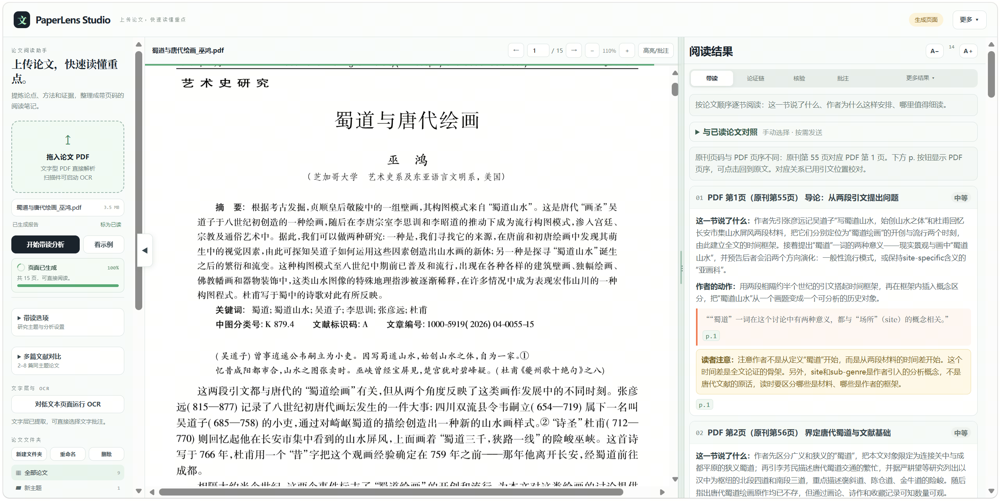

图 1：以巫鸿《蜀道与唐代绘画》为例，左侧可见上传、页面生成和带读入口，中间是 PDF 原文，右侧同时展示逐节解释、作者的写作动作及“读者注意”。原刊第 55 页对应 PDF 第 1 页，可点页码返回原文。截图由使用者提供，原文版权归原权利人。

## 目录

- [快速开始](#快速开始)
- [第一次带读一篇论文](#第一次带读一篇论文)
- [怎样读懂右侧结果](#怎样读懂右侧结果)
- [原文定位、缩放与批注](#原文定位缩放与批注)
- [已读、收藏和文件夹](#已读收藏和文件夹)
- [两种跨论文功能](#两种跨论文功能)
- [导出、备份与迁移](#导出备份与迁移)
- [隐私与使用边界](#隐私与使用边界)
- [常见问题](#常见问题)
- [发布到 GitHub 前](#发布到-github-前)

## 快速开始

### 运行条件

- 软件：Node.js 18 或更高版本。终端输入 `node -v` 可检查是否已安装。
- 现代桌面浏览器：Edge 浏览器或 Chrome 浏览器都可以。首次打开页面需要联网加载 PDF.js；OCR 和批注版 PDF 导出也会按需加载外部组件。
- API Key：若要使用 AI 分析，还需要一个支持 Chat Completions 格式、允许浏览器跨域请求（CORS）的接口、模型名称和 API Key。项目**不附带模型额度或密钥**。

### Windows

1. 下载或克隆本仓库，保持文件结构不变。
2. 双击 `启动 PaperLens.bat`。它会启动本地服务并打开 `http://127.0.0.1:5173`。
3. 使用期间保留服务命令窗口；关闭窗口后，网页不再能从本地服务加载。

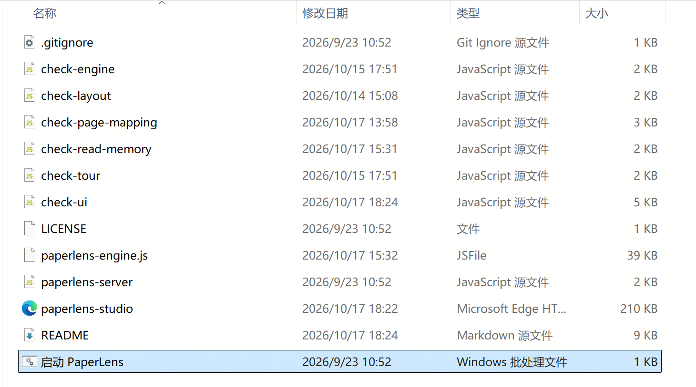

Windows 启动文件示意：如果系统隐藏了 `.bat` 扩展名，截图中选中的“启动 PaperLens”（类型为“Windows 批处理文件”）就是第 2 步要双击的文件。

### macOS / Linux / 手动启动

在项目根目录运行：

```bash
node paperlens-server.mjs
```

然后在浏览器打开 `http://127.0.0.1:5173`。本项目没有 `npm install` 步骤。建议通过这个本地地址使用，不要直接双击 HTML 文件。

首次进入会出现七步使用引导；可跳过，以后在右上角 **更多 → 使用引导** 中重看。想先熟悉页面，可以点左侧 **看示例**；示例不需要配置 AI，也不会代替自己的论文分析。

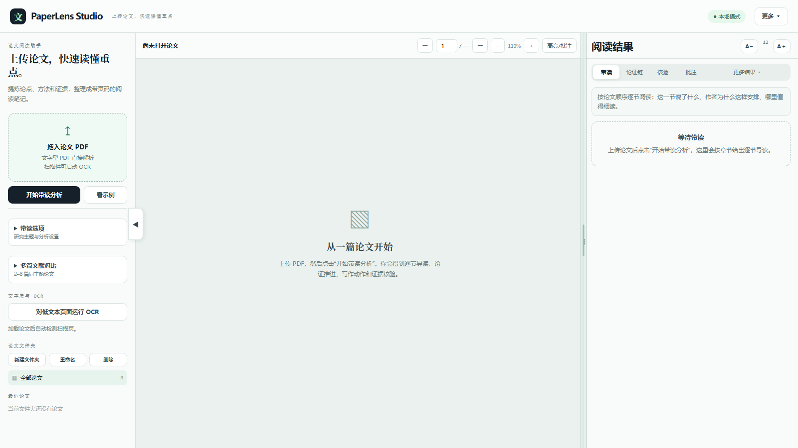

图 2：尚未开始分析时，左侧负责上传和管理，中间阅读 PDF，右侧展示阅读结果；这张图使用合成测试内容。

### 配置 AI 接口

进入 **更多 → AI 接口设置**，填写：

| 项目 | 填什么 |
| --- | --- |
| Chat Completions Endpoint | 你自己服务的完整接口地址，例如 `https://你的服务地址/v1/chat/completions` |
| 模型名称 | 该服务支持的模型 ID |
| API Key | 该服务提供的密钥；不要写进源码或提交到 GitHub |
| 分块大小、最多分析块数 | 影响长文分析覆盖范围、耗时和接口费用；先使用默认值即可 |

点击 **保存** 后再分析。页面会把论文中抽取的文字发送到你配置的接口；没有配置接口时，仍可打开 PDF、翻页、批注、整理文件夹和查看本地已有结果。若接口报跨域错误，需由接口提供方允许浏览器请求，或使用你自己控制的安全后端代理。

## 第一次带读一篇论文

1. 在左侧 **拖入论文 PDF**，或点击上传区选文件。上传后会先解析、显示原文，**不会自动调用 AI**。
2. 如果页面提示文字很少，论文可能是扫描件；在左侧点击 **对低文本页面运行 OCR**，完成后再分析。OCR 需要额外加载语言资源，耗时取决于页数和设备。
3. 可选：展开 **带读选项**，填写自己的研究主题，或调整“分块精读 / 带读视图 / 证据核验”。研究主题留空也能正常分析。
4. 点击 **开始带读分析**。长文会分块处理，请等待进度完成；分析过程中不要关闭页面。
5. 从右侧 **带读** 开始读，再按需要切到 **论证链** 和 **核验**，随时点页码回到中间 PDF。

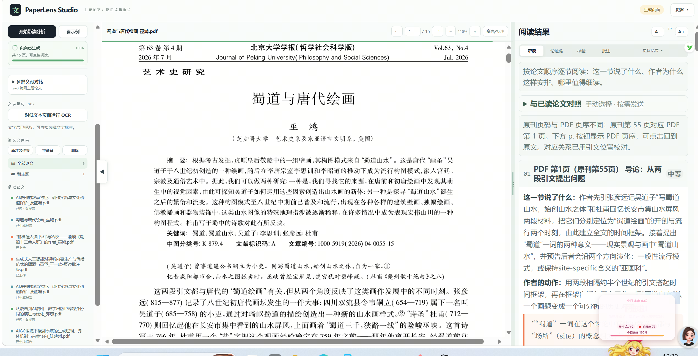

图 3：同一篇 15 页论文在真实论文库中的阅读状态。左侧管理多篇文献，中间查看原文，右侧按顺序显示导读卡片和页码映射提示；分析内容需要结合原文核对。

重复上传同一份 PDF（即使改了文件名）通常会打开原记录，保留报告、批注、已读状态和文件夹；它不会自动合并旧版本已经存在的重复记录。

## 怎样读懂右侧结果

| 入口 | 适合回答的问题 | 使用提醒 |
| --- | --- | --- |
| **带读** | 每节说了什么、作者为什么这样安排、哪里值得细读？ | 按原文顺序阅读；复杂概念要回到原段落。 |
| **论证链** | 研究问题 → 核心主张 → 论据与论证推进 → 写作动作，是怎样连起来的？ | 可收藏值得复用的观点或写法。 |
| **核验** | 报告提到的页码、引文和原文候选句能否找到？ | 找到相似文字不等于论点已成立，仍要看上下文。 |
| **批注** | 我自己标记了什么？收藏了哪些写作素材？ | 批注和收藏都保存在当前浏览器的本地数据中。 |
| **更多结果** | 文献综述、研究迁移、思维导图在哪里？ | 文献综述通常在完成多篇文献对比后使用。 |

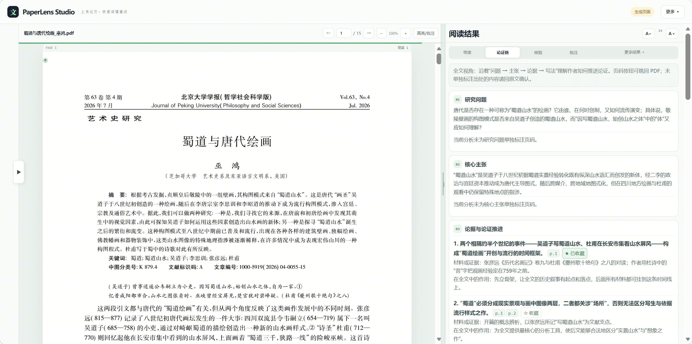

图 4：真实论文的论证链上半部分。左边是 PDF，右边依次呈现研究问题、核心主张和论据。研究问题与核心主张没有被标成某一句的精确引文，界面也会明确提示这一点。

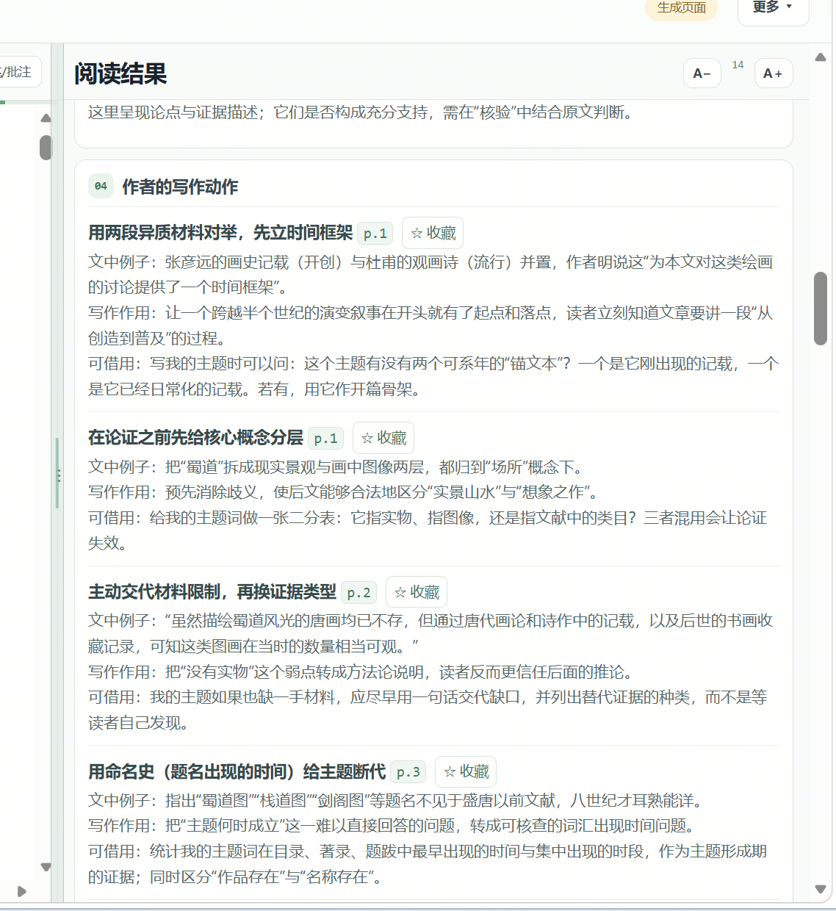

图 5：同一条论证链向下滚动后的“作者的写作动作”。它把原文例子、写作作用和可借鉴之处放在一起；页码按钮用于返回 PDF 核对。

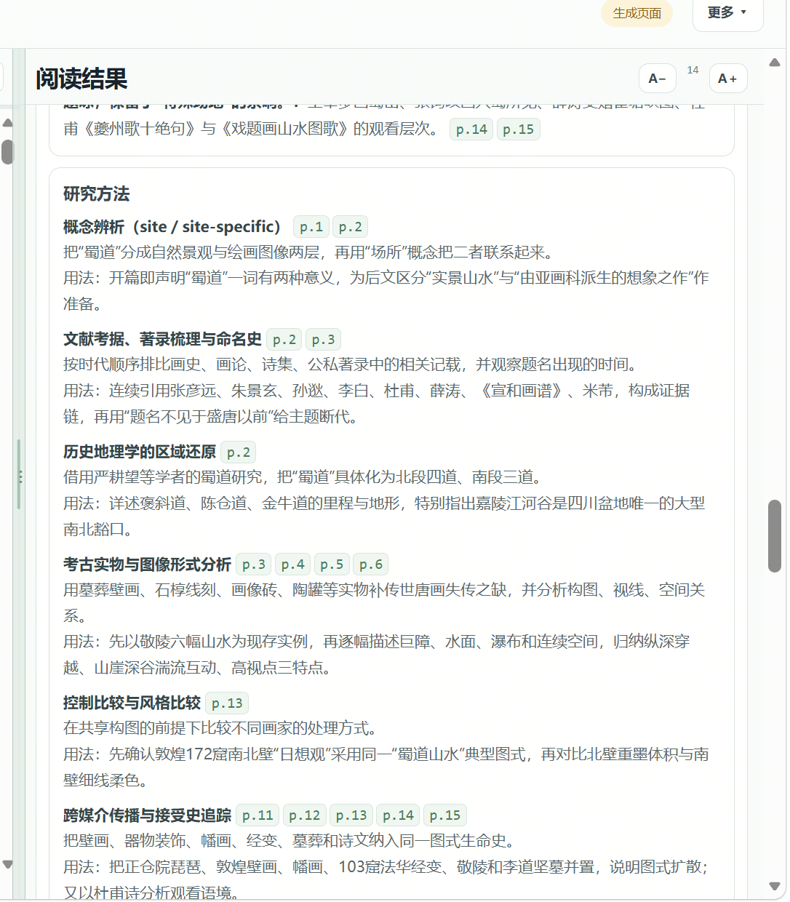

图 6：右侧结果还会整理研究方法，例如概念辨析、史料梳理与图像形式分析，并附 PDF 页序。这些是分析提示，不是可以直接替代原文的研究方法结论。

切到 **核验** 可以检查页码和引文候选句。下图中 PDF 页码内容可读取，但引文仍有“对位不明确”和“定位异常”；可读取不代表引文已核实，更不代表论点成立。

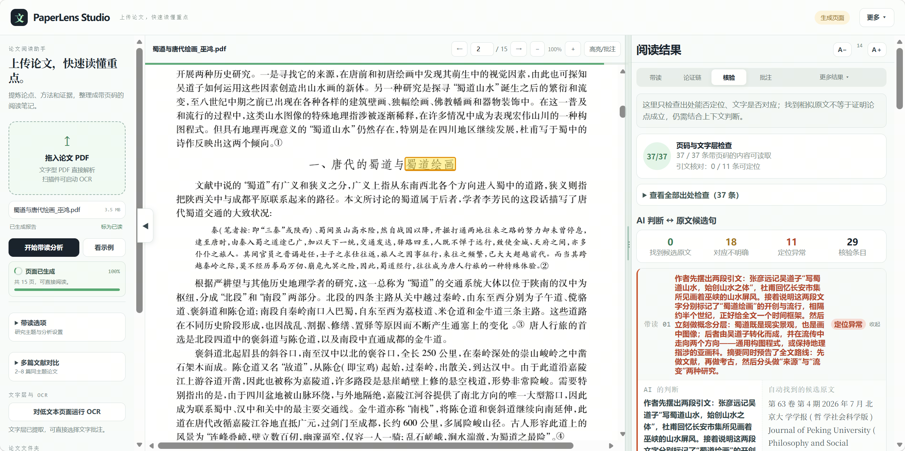

图 7：核验是风险提示，不是自动验真的结论。尤其遇到“定位异常”时，应回到 PDF 查看上下文，不能直接引用报告文字。

想快速抓重点，可打开 **更多结果 → 思维导图**，先看“主张 / 可借鉴 / 核对”提示，再决定读哪些段落。导图有独立缩放按钮，也可下载 SVG。

右栏标题旁的 **A− / A＋** 可把分析文字调到 10–24px，设置会被记住。桌面端可拖动中间与右栏的边界，或在 **更多** 中选“右栏窄 / 右栏宽”；窄屏时用 PDF 工具栏的 **阅读结果** 打开结果抽屉。

## 原文定位、缩放与批注

### 页码与阅读位置

- 中间顶部的页码和结果里的 `p.数字` 指的是 **PDF 文件中的页序**，不一定等于期刊印刷页码。例如原刊第 55 页可能是这个 PDF 的第 1 页。
- 点击有定位能力的页码标识可跳回原文；如果显示“未定位”或“页码待核对”，请不要把模型给出的数字当成准确出处。
- PDF 工具栏的 `− / ＋` 直接缩放页面，尽量保持当前阅读位置；翻页或滚动后，再次从“最近论文”打开会恢复上次位置。

### 选中文字并高亮

1. 在 PDF 原文上拖选文字。浅蓝色区域表示本次选中的范围，底下仍能看清原文。
2. 点击顶部 **高亮/批注**，或在选区上右键。
3. 在弹出的调色板中选黄、绿、蓝、粉、紫；若还想写备注，先勾选 **同时添加文字批注**。
4. 保存后到右侧 **批注** 查看；点击批注可返回 PDF 对应页。旧版未记录颜色的高亮仍按黄色显示。

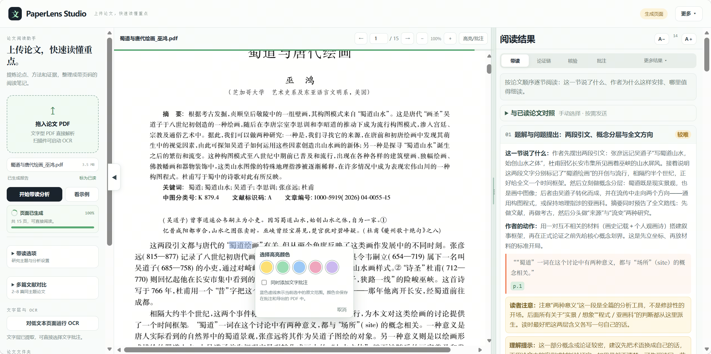

图 8：真实 PDF 中浅蓝色是“当前选区”，不是已保存的高亮颜色；弹出的调色板可选黄、绿、蓝、粉、紫。扫描页若没有可选文字，先运行 OCR。

## 已读、收藏和文件夹

### 三种论文状态

| 状态 | 怎样产生 | 它表示什么 |
| --- | --- | --- |
| **已上传** | 添加 PDF 后自动出现 | 论文在本地库中，不代表读过。 |
| **已生成报告** | 带读分析完成后自动出现 | 已有报告，不代表读者读完。 |
| **已读** | 读者手动点 **标为已读**，或在最近论文上右键设置 | 是读者自己的阅读标记，可撤销；最近论文显示绿色圆点。 |

即使只阅读了原文、没有生成报告，也可以手动标“已读”。“记住阅读位置”与“已读”是两件独立的事。

### 收藏可复用的观点与写法

在 **论证链** 的论据或“作者的写作动作”旁点 **☆ 收藏**；到 **批注 → 我的写作素材** 查看、移除或跳回来源 PDF。收藏的是报告中的表述，真正引用前必须核对原文和上下文。

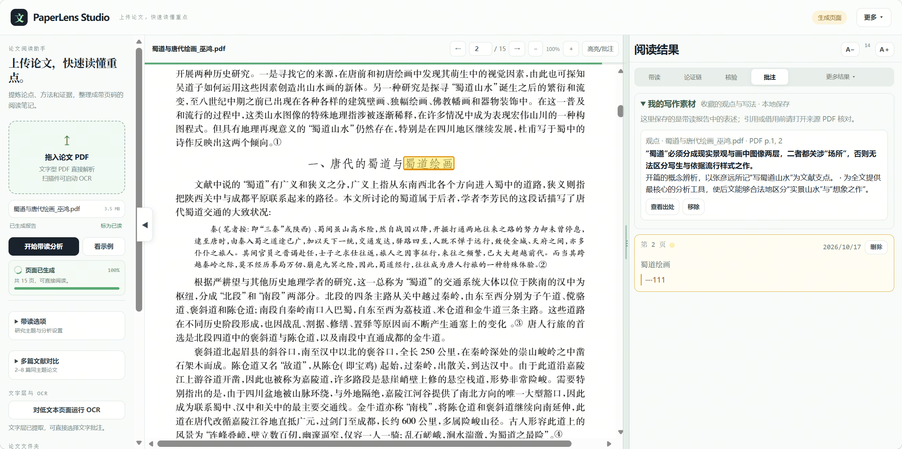

图 9：同一篇论文中保存的黄色高亮与一条观点收藏。收藏项带来源论文和 PDF 页序；“查看出处”只帮助定位，不替代人工核对。

### 按主题分类

左侧 **论文文件夹** 可新建、重命名、删除分类；在 **最近论文** 中右键某篇论文，可将它移入文件夹，也可手动切换已读状态。操作删除论文前，建议先通过 **更多 → 备份工作台数据** 留存数据。

## 两种跨论文功能

这两个入口作用不同，不必每次都使用。

### A. 多篇文献对比：新建一份文献组分析

在左侧展开 **多篇文献对比**，选择 **2–8 篇同主题 PDF**，点击 **开始文献组对比**。完成后到右侧 **更多结果 → 文献综述** 查看论点、方法、证据矩阵及研究空白。它面向“这一组论文之间怎么比较”，会调用你配置的 AI 接口；矩阵可横向滚动、调整列宽和字号。

### B. 与已读论文对照：本篇报告和指定旧报告比

先给之前读过的论文手动标 **已读**，并确保它们有带读报告。然后打开当前论文的 **带读 → 与已读论文对照 → 选择已读报告**，仅勾选想比较的论文（最多 8 篇）。页面会先展示准备发送的报告片段；确认后才会把当前报告和所选旧报告摘要发送到你配置的 AI 接口，**不会自动发送未选论文或 PDF 全文**。

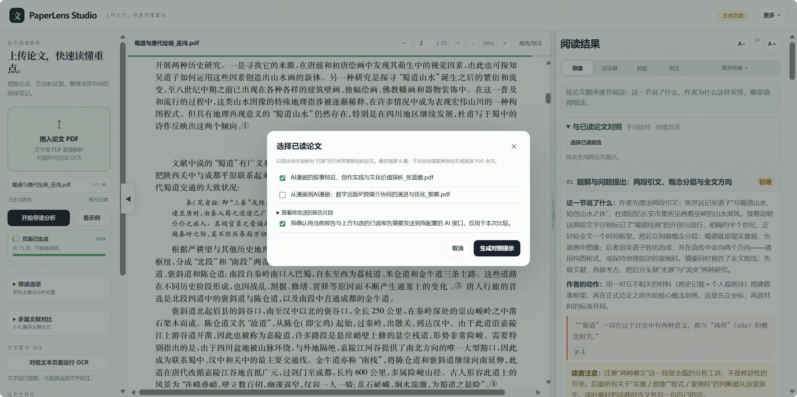

图 10：真实使用中的确认对话框只列出手动标“已读”且已有报告的论文；可展开查看拟发送的报告片段，确认后才生成对照提示。截图停在发送前。

结果会标为 **此前已见 / 相近但有差异 / 在已读库中未见**，并附来源论文；能定位时可点回来源 PDF。这里的“未见”只表示**本次勾选的已读报告中没有发现**，绝不表示该观点在学术界是全新的。若旧报告更新或来源取消“已读”，已保存的对照提示会失效，需要重新选择。

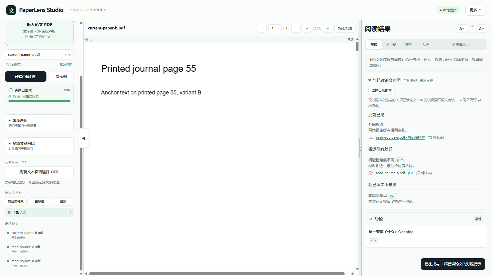

图 11：这里使用合成测试报告演示结果样式。请将分类当成检索提示，再读来源段落判断是否真的相同、不同。

## 导出、备份与迁移

右上角 **更多** 集中了导出与数据管理：

| 操作 | 得到什么 | 注意 |
| --- | --- | --- |
| 带读报告 · HTML | 带颜色和章节排版的 `.html` | 需要先生成带读报告。 |
| 带读报告 · Word | 可用 Word/WPS 打开的 `.doc` | 这是 HTML 格式的 Word 兼容文件，不是 `.docx`。 |
| 带读报告 · PDF | 打开浏览器打印界面 | 在打印窗口选择“另存为 PDF”；若弹窗被拦截，先允许弹窗。 |
| 导出批注版 | 保留原文、叠加彩色高亮及页边文字批注的 PDF | 需要已有批注；首次点击需联网加载 pdf-lib；原 PDF 不会被覆盖。 |
| 备份工作台数据 | 一个 JSON 文件 | 包含本地 PDF、报告、批注、收藏和文件夹，可能含敏感研究资料。 |
| 导入工作台数据 | 恢复备份中的记录 | 导入前也先备份现有数据；不要把备份 JSON 上传到公开仓库。 |

**升级或换浏览器前先备份。**本地地址、浏览器和 GitHub Pages 地址属于不同站点，浏览器不会自动共享它们的论文库；在新地址使用时需要手动导入备份。清理浏览器站点数据或使用无痕模式，也可能让本地数据不可用。

## 隐私与使用边界

- 论文文件、报告、批注、收藏和文件夹默认存于当前浏览器的 IndexedDB；上传到 GitHub 的**代码仓库不会自动得到这些数据**。
- AI 分析会把提取出的论文文字发送到你配置的接口。跨论文“与已读论文对照”则在你明确勾选、预览并同意后发送所选报告摘要。请按论文和笔记的敏感程度选择服务。
- API Key 保存在当前浏览器会话的 `sessionStorage`，**不应写入源码、截图、Issue 或备份文件**。公开部署的前端不适合作为长期密钥的安全代理。
- 页面依赖外部 CDN 加载 PDF.js、OCR 组件及按需导出的 pdf-lib；因此“本地优先”不等于完全离线。OCR 在浏览器中运行，但组件和语言资源可能需要网络。
- 模型可能误读引文、页码、证据关系和学术新意。核验面板只检查出处和文字对应的线索，不能替你完成学术审读。

## 常见问题

<details>
<summary>页面打开了，但 PDF.js 未加载或 PDF 一直不能显示？</summary>

确认网络可访问项目使用的 CDN；关闭旧版本服务后，从本仓库目录重新启动，并尝试强制刷新浏览器缓存。不要直接双击 `paperlens-studio.html`。

</details>

<details>
<summary>AI 接口提示 CORS、401、404 或模型错误？</summary>

检查 Endpoint 是否为兼容的 Chat Completions 地址、模型 ID 和密钥是否有效。401 通常与鉴权有关；404 常见于路径或模型配置；CORS 需由接口服务端或你自己的代理解决，浏览器页面不能单方面绕过。

</details>

<details>
<summary>为什么原刊第 55 页会跳到 PDF 第 1 页？</summary>

结果页码以 PDF 文件页序为准。原刊页码可能从 55 开始，但这篇下载的 PDF 只有 15 页。若结果提示“未定位”，不要强行按原刊页码跳转。

</details>

<details>
<summary>换浏览器或清理缓存后，论文和批注不见了？</summary>

数据属于原浏览器的站点存储，不会自动云同步。若之前用 **备份工作台数据** 导出过 JSON，可在新环境用 **导入工作台数据** 恢复。

</details>

<details>
<summary>5173 端口被占用怎么办？</summary>

先关闭旧的 PaperLens 服务窗口，或在终端为服务器指定其他端口，例如 PowerShell：`$env:PORT=5174; node paperlens-server.mjs`。之后手动打开 `http://127.0.0.1:5174`；双击脚本仍会尝试打开默认的 5173 端口。

</details>

## 发布到 GitHub 前

1. 上传**本目录内的文件和 `docs/images/`**，不要只上传 ZIP，否则 GitHub 首页不会自动展示这份 README 和截图。
2. 确认仓库是公开还是私有；不要提交真实论文 PDF、工作台备份 JSON、API Key 或个人研究记录。本 README 中《蜀道与唐代绘画》的截图是真实使用画面，能看到论文页面、其他论文文件名和阅读状态；公开前请再次确认这些内容适合展示，并自行核实论文页面的展示权利。标注“合成示例”的图片不含真实论文。
3. 检查 `LICENSE`：当前文件是待完善的许可文本，版权主体未填写。请在公开发布前自行决定许可并补全，不要把它误当成已经完成的授权声明。
4. 上传后打开仓库首页，确认相对路径图片正常显示，并按上面的快速开始步骤实际运行一次。

项目自检可在根目录依次运行：

```bash
node check-engine.mjs
node check-page-mapping.mjs
node check-read-memory.mjs
node check-tour.mjs
node check-layout.mjs
node check-ui.mjs
```

这些脚本检查分析数据兼容、页码定位、跨论文发送范围、引导、布局和关键 UI 路径；它们不代替用真实论文做人工验收。
